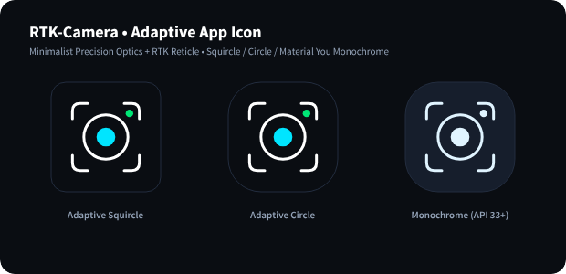
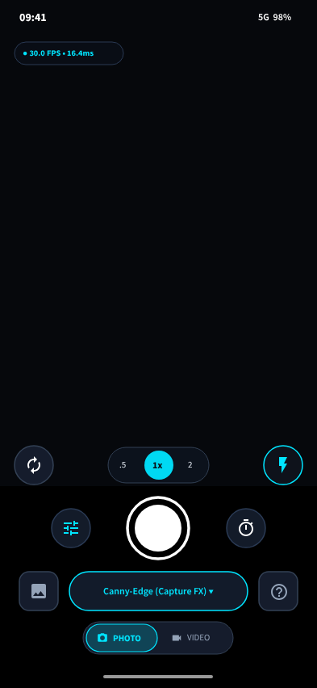
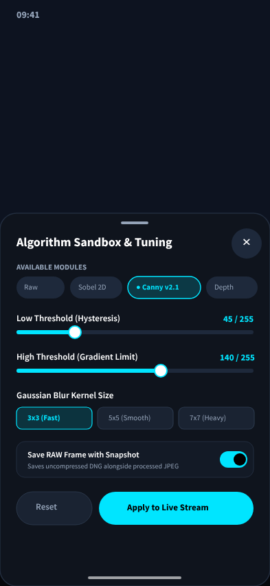
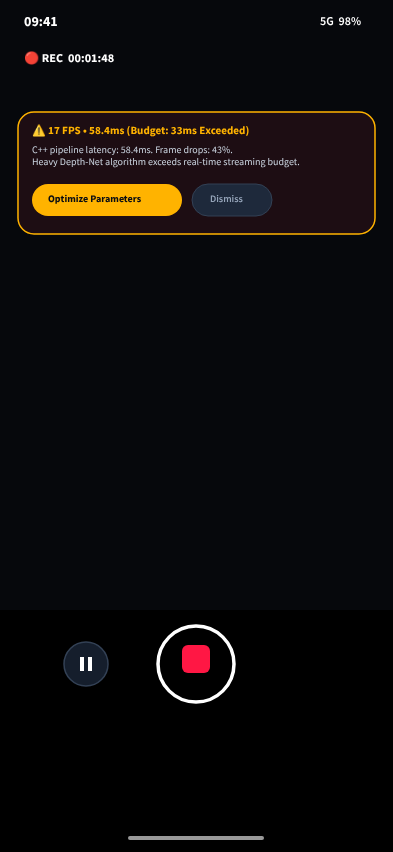
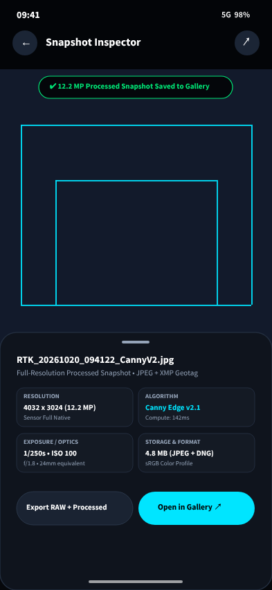
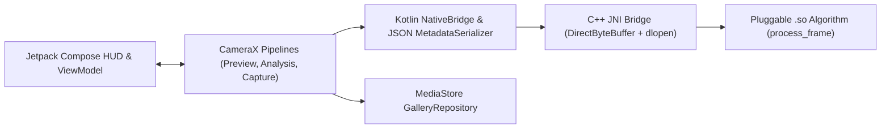

<p align="center">
  
</p>

<h1 align="center">RTK Camera</h1>

<p align="center">
  <strong>Open-source Android camera application sandbox for real-time image processing, computer vision, and embedded AI algorithms.</strong>
</p>

<p align="center">
  
  
  
  
  
</p>

---

## Overview

**RTK Camera** decouples mobile camera infrastructure from computer vision algorithm development. Instead of wrestling with Android lifecycles, CameraX configuration, orientation math, and storage permissions, researchers and engineers write native C++/Rust algorithms against a single C entry point (`process_frame`), compile a `.so` plugin, and test it directly on live sensor streams and full-resolution captures.

### Key Capabilities

- **Plug-and-Play Native Plugins**: Dynamically load compiled `.so` shared libraries via POSIX `dlopen`/`dlsym` against a minimal C ABI ([`plugin_contract.h`](app/src/main/cpp/contracts/plugin_contract.h)).
- **Zero-Copy JNI Frame Passing**: Delivers raw camera frame buffers directly to native code using `DirectByteBuffer` (`GetDirectBufferAddress`) to meet `< 33ms` (30 FPS) real-time budgets.
- **Standardized Metadata Context**: Every frame is accompanied by an extensible JSON `CameraMetadata` bundle (`width`, `height`, `stride`, `format`, `orientation`, `timestamp`).
- **Real-Time Telemetry & Performance Safeguards**: Live FPS/latency HUD with automatic frame-dropping and non-blocking `> 33ms` latency warnings to keep the UI responsive.
- **Dual Processing Paths**: Separate pipelines for low-latency live preview analysis (`AnalysisPipeline`) and full-resolution gallery persistence (`CapturePipeline` + `GalleryRepository` via `MediaStore`).
- **Tactical Field-Ready UI**: Edge-to-edge Jetpack Compose viewfinder with high-contrast scrims, algorithm tuning drawer, pro camera parameters, intervalometer/burst sheet, and a full-resolution Snapshot Inspector.

---

## UI Preview

<table>
  <tr>
    <td align="center" width="25%">
      <br/>
      <sub><b>Viewfinder HUD</b></sub>
    </td>
    <td align="center" width="25%">
      <br/>
      <sub><b>Algorithm Tuning</b></sub>
    </td>
    <td align="center" width="25%">
      <br/>
      <sub><b>&gt;33ms Latency Alert</b></sub>
    </td>
    <td align="center" width="25%">
      <br/>
      <sub><b>Snapshot Inspector</b></sub>
    </td>
  </tr>
</table>

---

## Architecture at a Glance



For full architectural diagrams, sequence flows, data contracts, personas, and design trade-offs, read the **[High-Level Design (docs/HLD.md)](docs/HLD.md)**.

---

## Quick Start

### Prerequisites

- **Android Studio** (or Gradle CLI) with **JDK 17**
- **Android SDK 34** (minSdk 24)
- **Android NDK** and **CMake 3.22.1**
- Physical Android device (API 24+) with USB debugging enabled

### Build & Install

```bash
git clone https://github.com/reyotak/rtk-camera.git
cd rtk-camera
./gradlew installDebug
```

### Write a Custom Plugin

Implement the C contract in [`app/src/main/cpp/contracts/plugin_contract.h`](app/src/main/cpp/contracts/plugin_contract.h):

```c
#include "contracts/plugin_contract.h"

extern "C" int process_frame(uint8_t* frame_data, const char* metadata_json) {
    // Process frame_data in-place using dimensions/orientation from metadata_json
    return 0; // 0 = success
}
```

See [`app/src/main/cpp/plugin/dummy_plugin.cpp`](app/src/main/cpp/plugin/dummy_plugin.cpp) for a reference implementation and [docs/HLD.md](docs/HLD.md#43-developing-a-custom-native-algorithm-plugin) for full build and loading details.

### Run Tests

```bash
# Kotlin JVM unit tests
./gradlew test

# Instrumented Compose UI tests (requires device/emulator)
./gradlew connectedAndroidTest

# Desktop C++ GoogleTest suite (metadata parser)
cmake -S app/src/cpptest -B build-cpptest
cmake --build build-cpptest
ctest --test-dir build-cpptest --output-on-failure
```

---

## Tech Stack

- **Android & UI**: Kotlin `2.0.21`, Jetpack Compose (Material 3), CameraX `1.3.0`, Dagger Hilt `2.52`, Coroutines/Flow, `kotlinx-serialization-json`
- **Native**: C++17, Android NDK, JNI, CMake `3.22.1`, POSIX `dlfcn`, `nlohmann/json`
- **Testing**: JUnit 4, MockK, Espresso, Compose UI Test, GoogleTest

---

## Documentation

- **[High-Level Design (HLD)](docs/HLD.md)** — Purpose, personas, use cases, Mermaid architecture & sequence diagrams, plugin contracts, design trade-offs, and roadmap.

---

## Contributing & License

Contributions, custom sample plugins, and bug reports are welcome! Please use the templates under [`.github/`](.github/) when opening issues or pull requests.

Licensed under the **[Apache License 2.0](LICENSE)**.
