<p align="center">
  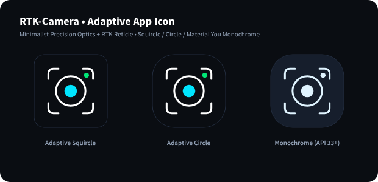
</p>

# RTK Camera — High-Level Design (HLD)

**Document Version**: 1.0  
**Target Platform**: Android (API 24+ / compileSdk 34)  
**License**: Apache License 2.0  

---

## Table of Contents

1. [Purpose, Vision & Core Principles](#1-purpose-vision--core-principles)
2. [Stakeholders & User Personas](#2-stakeholders--user-personas)
3. [Use Cases & User Experience](#3-use-cases--user-experience)
4. [How to Use](#4-how-to-use)
5. [Technology Stack](#5-technology-stack)
6. [System Architecture & Design](#6-system-architecture--design)
7. [Data Contracts & Models](#7-data-contracts--models)
8. [Key Architectural Decisions & Trade-Offs](#8-key-architectural-decisions--trade-offs)
9. [Repository Structure](#9-repository-structure)
10. [Non-Functional Requirements & Success Criteria](#10-non-functional-requirements--success-criteria)
11. [Current Implementation Status & Roadmap](#11-current-implementation-status--roadmap)

---

## 1. Purpose, Vision & Core Principles

### 1.1 Purpose

**RTK Camera** is an open-source Android camera application sandbox purpose-built for **image processing, computer vision (CV), and embedded AI algorithm development**.

Building and testing custom vision algorithms on mobile hardware normally requires researchers to spend days wiring Android camera lifecycles, orientation transforms, buffer formats, UI overlays, and storage permissions before testing a single line of algorithmic code. RTK Camera eliminates that friction by providing a **reusable, high-performance mobile host infrastructure** paired with a **minimal C ABI plugin contract**. Algorithm specialists compile native logic into a shared library (`.so`), load it into the sandbox, evaluate real-time latency and frame drops on live sensor feeds, tune parameters interactively, and capture full-resolution processed snapshots directly to the device gallery.

### 1.2 Architectural Principles

All design and implementation decisions in RTK Camera are governed by five foundational architectural principles:

| # | Principle | Mandate |
| :--- | :--- | :--- |
| **I** | **Infrastructure / Algorithm Decoupling** | Strict separation between the Mobile Infrastructure layer (hardware abstraction, CameraX lifecycle, Jetpack Compose UI) and the Algorithm Processing layer. Algorithm authors operate in a stable native environment insulated from Android host updates. |
| **II** | **Standardized Mobile Data Contracts** | All exchanges between camera infrastructure and native plugins adhere to versionable, explicit contracts: a single C entry point (`process_frame`) and an extensible JSON metadata bundle (`CameraMetadata`). |
| **III** | **High-Fidelity & Real-Time Performance** | Two distinct, reliable processing paths: (1) low-latency real-time stream analysis with frame-dropping to protect UI responsiveness, and (2) deterministic full-resolution snapshot capture destined for persistent storage. |
| **IV** | **Contextual Metadata Integrity** | Every sensor frame delivered to an algorithm includes its spatial and sensor context (dimensions, row stride, pixel format, orientation degrees, timestamp), structured for future sensor extensions (RTK GNSS, IMU, Depth). |
| **V** | **Platform-Agnostic Developer Experience** | Specialists without Android expertise interact only with a standard C header (`plugin_contract.h`) and desktop-testable C++/Rust code, requiring zero knowledge of Android lifecycles or JNI boilerplate. |

### 1.3 UX & Ergonomic Design Principles

From the project's human-centered design research (Penpot Design System):

1. **Contrast Scrims**: Camera feeds range from bright outdoor skies to deep shadows; top and bottom viewport regions apply translucent dark gradient scrims to preserve AAA HUD legibility.
2. **Performance Decoupling**: The UI render loop stays responsive regardless of algorithm compute cost. If frame analysis exceeds the 33ms budget (30 FPS), the system drops analysis frames and surfaces a non-blocking performance warning banner with one-tap access to parameter tuning.
3. **Ergonomic Thumb Zone**: Primary interactive controls (76dp tactile shutter, zoom pill, flash toggle, camera switch, gallery shortcut, active algorithm pill, capture mode strip, and modal drawers) are anchored in the lower thumb reach zone for reliable one-handed field operation.

---

## 2. Stakeholders & User Personas

| Stakeholder | Role / Persona | Primary Goals | Key Pain Points Addressed |
| :--- | :--- | :--- | :--- |
| **CV & Embedded AI Researchers** *(Primary Persona)* | **Dr. Maya Lin** — Senior Computer Vision & Embedded AI Researcher | Hot-swap custom C++/Rust filters on live 1080p/4K feeds; inspect live ms latency, FPS, and frame-drop telemetry; tune thresholds via tactile sliders; A/B compare raw vs. processed streams. | UI freezes when heavy algorithms block rendering; missing orientation metadata corrupting coordinate matrices; slow APK rebuild loops. |
| **Field QA & Photogrammetry Technicians** *(Secondary Persona)* | **Alex Rivera** — Field QA Specialist & Photogrammetry Technician | Capture repeatable high-resolution survey samples outdoors with one hand; rely on high-contrast HUD affordances and clear RTK/capture status; persist full-res processed images reliably to device storage. | Tiny touch targets unusable outdoors; ambiguity over RAW vs. processed captures; unreliable media indexing. |
| **Mobile Infrastructure Maintainers** | Android / NDK Platform Engineers | Maintain CameraX bindings, zero-copy JNI bridge, Hilt DI graph, and Compose HUD without coupling to third-party algorithm internals. | Tightly coupled native singletons that break unit tests; fragile `SurfaceView`/`TextureView` orientation math. |
| **Open-Source Contributors** | External Developers & Academics | Contribute new sample plugins, UI diagnostics, metadata extensions (GPS/IMU/Depth), and cross-device compatibility improvements. | Lack of clear onboarding docs, contracts, or desktop-runnable native test harnesses. |

---

## 3. Use Cases & User Experience

### 3.1 Stakeholder & Use Case Overview

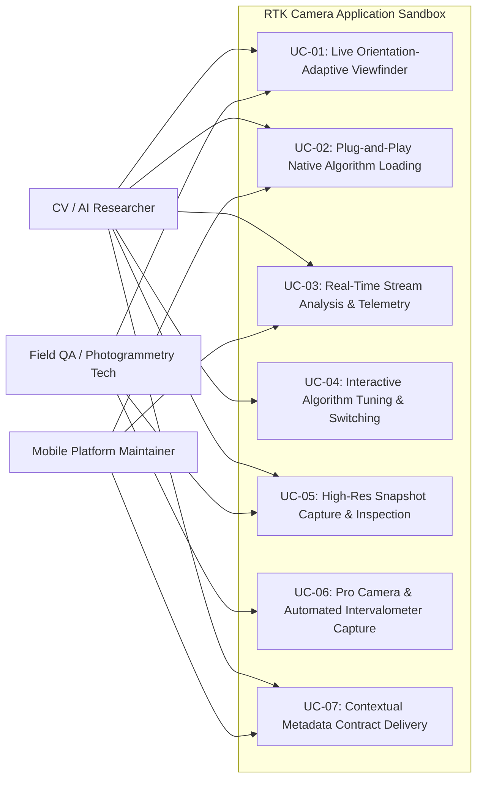

### 3.2 Core Use Cases

| ID | Use Case | Priority | Summary & Acceptance Criteria |
| :--- | :--- | :--- | :--- |
| **UC-01** | **Immediate Live Viewfinder & Orientation Adaptation** | P1 | On launch, after granting `CAMERA` permission, the back camera stream renders within 1 second behind all interactive HUD overlays and adapts smoothly to portrait/landscape orientation changes without distortion. |
| **UC-02** | **Plug-and-Play Algorithm Integration** | P1 | A developer supplies a compiled `.so` implementing `process_frame`. The host loads it dynamically via `dlopen`/`dlsym` without rebuilding the APK. |
| **UC-03** | **Real-Time Evaluation & Performance Safeguards** | P1 | Live frames are analyzed with zero-copy `DirectByteBuffer` access. Latency and FPS are polled for HUD telemetry; exceeding 33ms/frame triggers frame dropping (`STRATEGY_KEEP_ONLY_LATEST`) and displays a non-blocking **Low FPS Warning** banner. |
| **UC-04** | **Algorithm Management & Interactive Tuning** | P2 | Users switch active modules (e.g., Raw, Sobel 2D, Canny v2.1, Depth, or loaded `.so` plugins) and adjust parameters (thresholds, Gaussian kernel size, RAW pairing) via a slide-over drawer. |
| **UC-05** | **High-Fidelity Snapshot Capture & Review** | P2 | Triggering photo capture processes a full-resolution frame through the active algorithm path, persists the JPEG via Android `MediaStore` (`IS_PENDING` atomic commit), and exposes metadata in the **Snapshot Inspector** screen. |
| **UC-06** | **Pro Camera Controls & Automated Capture** | P2 | Operators override aspect/resolution, exposure bracketing, white balance, manual focus, shutter speed, and ISO, or arm burst/intervalometer/countdown sessions from dedicated bottom sheets. |
| **UC-07** | **Standardized Context Delivery** | P1 | Every frame passed to native code is paired with a JSON-serialized `CameraMetadata` payload containing `width`, `height`, `stride`, `format`, `orientation`, and `timestamp`. |

### 3.3 Application UI Showcase (Penpot High-Fidelity Screens)

<table>
  <tr>
    <td align="center" width="33%">
      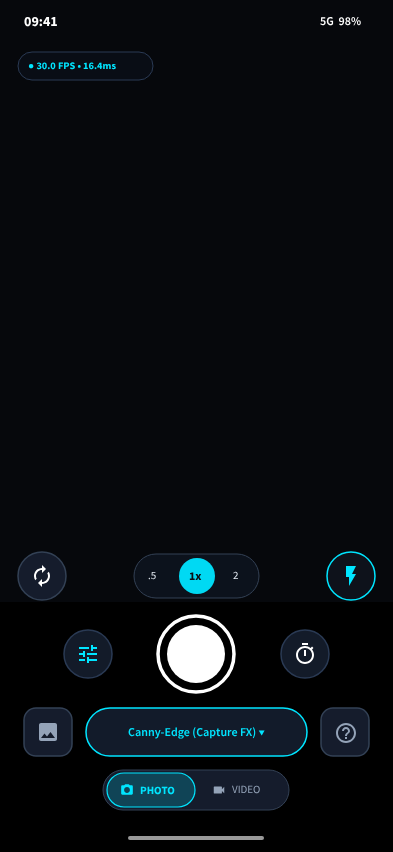<br/>
      <b>Viewfinder (Photo Idle)</b><br/>
      Live CameraX stream, top telemetry pill, zoom/flash bar, active algorithm pill, and ergonomic bottom deck.
    </td>
    <td align="center" width="33%">
      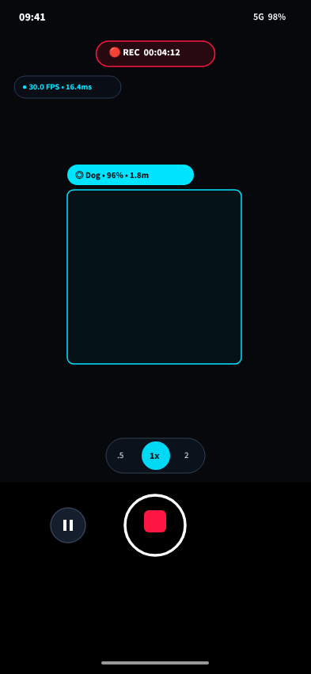<br/>
      <b>Active Stream & Telemetry</b><br/>
      Recording timer, live FPS/ms pill, optional AI tracking bounding box, and non-blocking HUD.
    </td>
    <td align="center" width="33%">
      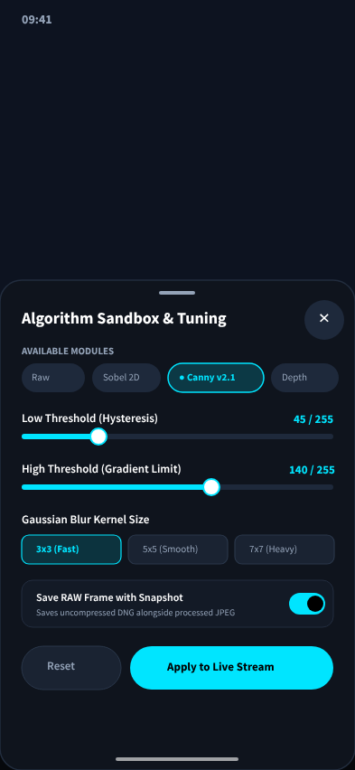<br/>
      <b>Algorithm Tuning Drawer</b><br/>
      Module switcher, live threshold sliders, kernel presets, and RAW+Processed toggle.
    </td>
  </tr>
  <tr>
    <td align="center" width="33%">
      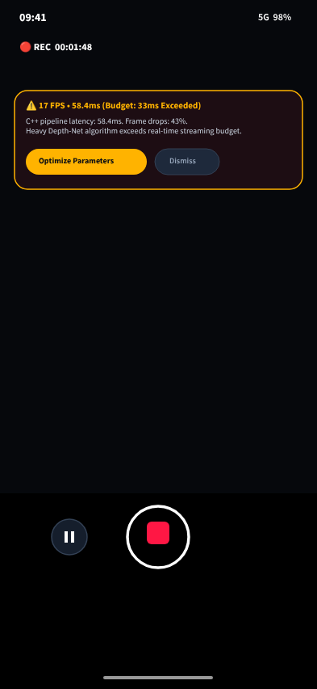<br/>
      <b>Performance Warning (&gt;33ms)</b><br/>
      Non-blocking latency alert with one-tap "Optimize Parameters" shortcut to protect 30+ FPS UI.
    </td>
    <td align="center" width="33%">
      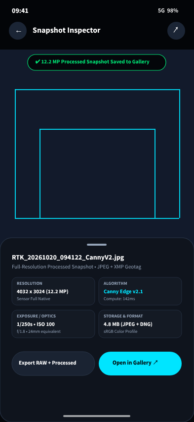<br/>
      <b>Snapshot Inspector</b><br/>
      Full-resolution capture review with resolution, compute time, optics, storage cards, and gallery export.
    </td>
    <td align="center" width="33%">
      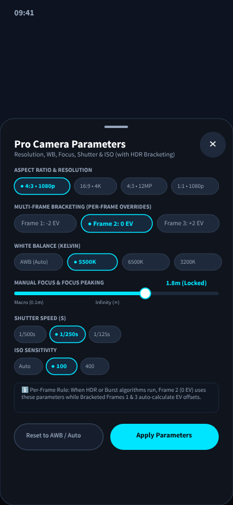<br/>
      <b>Pro Camera Parameters</b><br/>
      Aspect/resolution presets, exposure bracketing, white balance, manual focus, shutter speed, and ISO.
    </td>
  </tr>
</table>

<p align="center">
  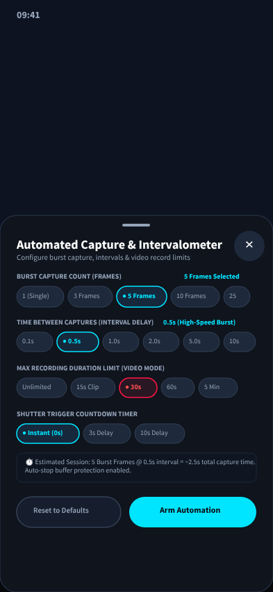<br/>
  <b>Automated Capture & Intervalometer</b> — Burst frame count, interval delay, max clip duration, and countdown timer arming.
</p>

---

## 4. How to Use

### 4.1 Prerequisites

- **JDK**: Java 17 (configured via Gradle `sourceCompatibility` / `targetCompatibility = 17`)
- **Android SDK**: Compile SDK 34, Minimum SDK 24 (Android 7.0+)
- **Android NDK & CMake**: CMake `3.22.1` and Android NDK installed via Android Studio SDK Manager (for compiling `librtkcamera.so` and `libdummy_plugin.so`)
- **Device**: A physical Android device (API 24+) with USB debugging enabled is strongly recommended for live CameraX preview validation (emulators typically provide synthetic camera feeds).

### 4.2 Building and Running the App

1. **Clone the repository**:
   ```bash
   git clone https://github.com/reyotak/rtk-camera.git
   cd rtk-camera
   ```
2. **Build and install the debug APK on a connected device**:
   ```bash
   ./gradlew installDebug
   ```
3. **Launch "RTK Camera"** on the device and grant the **Camera** permission when prompted.
4. **Navigate the HUD**:
   - **Viewfinder**: Tap anywhere on the preview to display the tap-to-focus reticle; switch between **Photo** and **Video** modes on the bottom strip; use the zoom pill (`.5`, `1x`, `2`), flash toggle (`Off` / `On` / `Auto`), and shutter button.
   - **Algorithm Tuning Drawer**: Tap the active algorithm pill (e.g., `Canny-Edge (Capture FX)`) to swap modules and tune processing parameters.
   - **Pro Parameters Sheet**: Tap the Pro controls icon on the bottom deck to override resolution, exposure bracketing, white balance, manual focus, shutter speed, or ISO.
   - **Automated Capture Sheet**: Tap the intervalometer icon to configure burst count, interval delay, video duration cap, or countdown timer, then tap **Arm**.
   - **Snapshot Inspector**: Tap the gallery thumbnail to inspect full-resolution snapshot metadata and export options.
   - **Help & Diagnostics Sheet**: Tap the Help (`?`) button to toggle the Rule-of-Thirds grid, aspect framing guides, telemetry HUD, demo AI tracking overlay, or simulated >33ms performance warnings.

### 4.3 Developing a Custom Native Algorithm Plugin

Algorithm authors only need to implement a single C function defined in [`app/src/main/cpp/contracts/plugin_contract.h`](../app/src/main/cpp/contracts/plugin_contract.h):

```c
#ifndef RTK_CAMERA_PLUGIN_H
#define RTK_CAMERA_PLUGIN_H

#include <stdint.h>

#ifdef __cplusplus
extern "C" {
#endif

/**
 * Processes a single frame in-place.
 * @param frame_data    Pointer to DirectByteBuffer memory (zero-copy).
 * @param metadata_json JSON-encoded string matching CameraMetadata schema.
 * @return 0 on success, non-zero error code otherwise.
 */
int process_frame(uint8_t* frame_data, const char* metadata_json);

#ifdef __cplusplus
}
#endif

#endif // RTK_CAMERA_PLUGIN_H
```

#### Minimal Example Plugin (`my_filter_plugin.cpp`)

```cpp
#include "contracts/plugin_contract.h"
#include "core/metadata_parser.h"

extern "C" int process_frame(uint8_t* frame_data, const char* metadata_json) {
    if (!frame_data || !metadata_json) {
        return -1;
    }

    CameraMetadata meta = parse_metadata(metadata_json);

    // Example: invert luma plane (Y plane in YUV_420_888)
    for (int y = 0; y < meta.height; ++y) {
        uint8_t* row = frame_data + (y * meta.stride);
        for (int x = 0; x < meta.width; ++x) {
            row[x] = static_cast<uint8_t>(255 - row[x]);
        }
    }

    return 0;
}
```

#### Compiling & Loading

- Add a `SHARED` target in [`app/src/main/cpp/CMakeLists.txt`](../app/src/main/cpp/CMakeLists.txt) (following `dummy_plugin`) or cross-compile an Android ABI-compatible `.so` using the Android NDK toolchain.
- Provide the `.so` path via `AlgorithmInfo(id, name, libraryPath)` to `NativeLoader.load(algorithm)` -> `NativeBridge.loadPlugin(path)`, which resolves `process_frame` via `dlopen` / `dlsym`.

### 4.4 Running Tests

```bash
# 1. Kotlin JVM unit tests (NativeLoaderTest, CameraUiStateTransitionsTest)
./gradlew test

# 2. Android instrumented Compose UI tests (ViewfinderTest — requires device/emulator)
./gradlew connectedAndroidTest

# 3. Desktop C++ native GoogleTest suite (metadata_parser tests)
cmake -S app/src/cpptest -B build-cpptest
cmake --build build-cpptest
ctest --test-dir build-cpptest --output-on-failure
```

---

## 5. Technology Stack

| Layer | Technology / Library | Version | Purpose |
| :--- | :--- | :--- | :--- |
| **App Language** | Kotlin | `2.0.21` | Primary Android application language (JVM Target 17) |
| **Build System** | Android Gradle Plugin / CMake | AGP `8.13.2` / CMake `3.22.1` | Multi-target Android + NDK native compilation |
| **UI Framework** | Jetpack Compose + Material 3 | BOM `2023.10.01` | Declarative HUD, modal bottom sheets, custom canvas overlays, edge-to-edge layout |
| **Camera Stack** | Android CameraX (`core`, `camera2`, `lifecycle`, `view`, `extensions`) | `1.3.0` | Hardware abstraction, `PreviewView`, `ImageAnalysis`, and `ImageCapture` |
| **Dependency Injection** | Dagger Hilt (`hilt-android`, `kapt`) | `2.52` | Decouples UI/camera pipelines from `AlgorithmProcessor` for runtime and test mockability |
| **Async & State** | Kotlin Coroutines & `StateFlow` (`lifecycle-runtime-compose`) | Lifecycle `2.6.2` | Lifecycle-aware reactive UI state, performance polling, capture timers |
| **JVM Serialization** | `kotlinx-serialization-json` | `1.6.0` | Serializes `CameraMetadata` into the cross-boundary JSON contract |
| **Native Bridge & Core** | C++17, Android NDK, JNI, POSIX `dlfcn` (`dlopen`/`dlsym`) | C++17 | Zero-copy `GetDirectBufferAddress` frame dispatch and dynamic `.so` plugin loader |
| **Native JSON** | `nlohmann/json` | `3.11.2` | Fetched via CMake `FetchContent` for robust native `CameraMetadata` parsing |
| **Media Persistence** | Android `MediaStore` (`ContentResolver`) | API 24+ (Scoped Storage Q+) | Atomic (`IS_PENDING`) public gallery persistence for high-resolution snapshots |
| **Testing** | JUnit 4, MockK, Espresso, Compose UI Test, GoogleTest | JUnit `4.13.2`, MockK `1.13.8`, GTest `1.14.0` | Unit tests for UI transitions & loader, UI tests for viewfinder, desktop C++ unit tests |

---

## 6. System Architecture & Design

### 6.1 Layered System Architecture

RTK Camera follows a strict **four-layer decoupled architecture** enforcing Constitution Principle I:

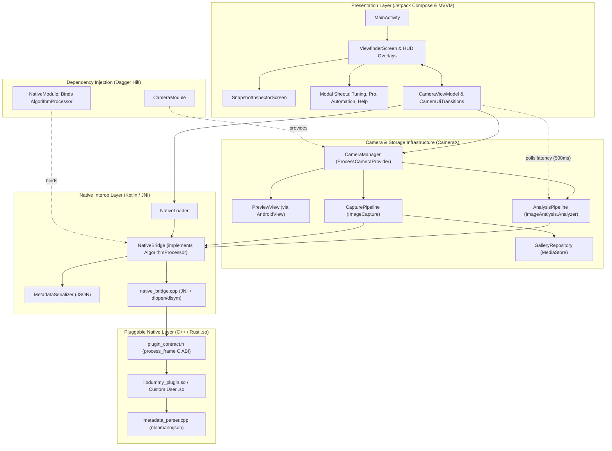

### 6.2 Real-Time Analysis Pipeline & Performance Safeguard

To guarantee a responsive 30–60 FPS viewfinder regardless of plugin complexity, the real-time path pairs CameraX's backpressure strategy (`STRATEGY_KEEP_ONLY_LATEST`) with zero-copy `DirectByteBuffer` invocation and asynchronous latency monitoring:

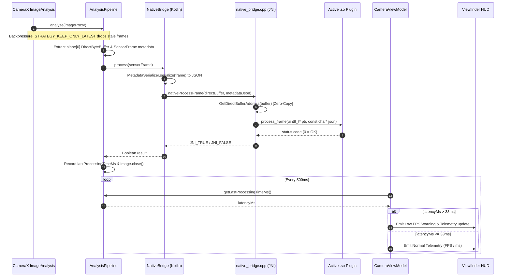

### 6.3 High-Resolution Snapshot Capture & Persistence

The snapshot path is deliberately separated from real-time analysis so full-resolution sensor frames can be processed deterministically and committed atomically to the Android public gallery:

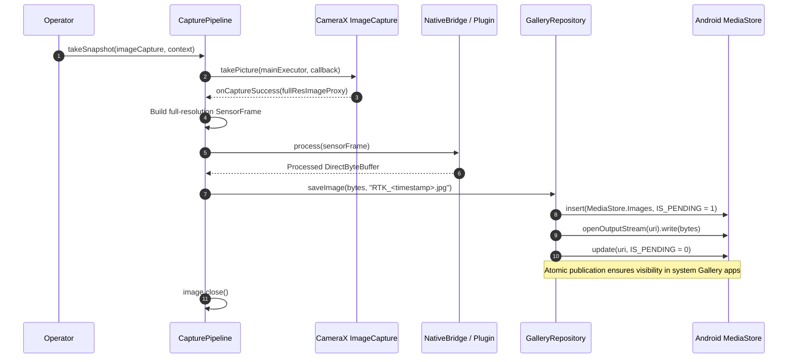

### 6.4 Core Component & Contract Relationships

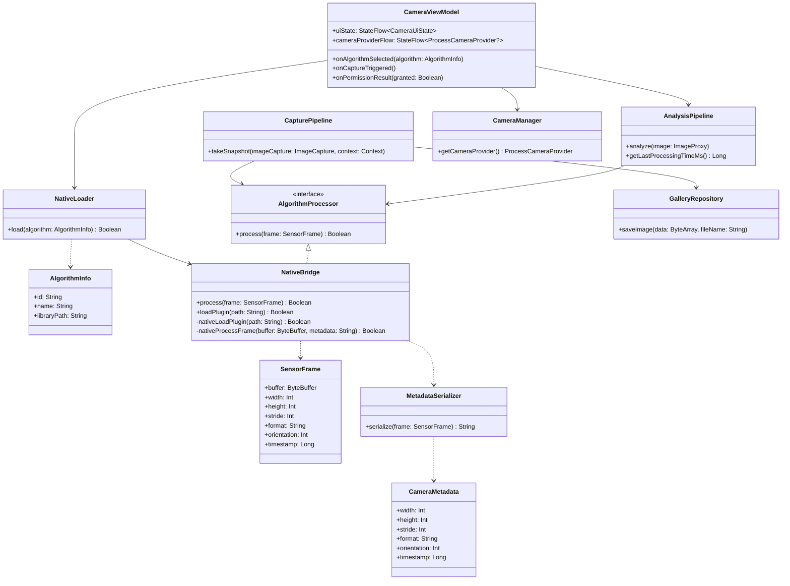

### 6.5 Pipeline & Capture Lifecycle State Machine

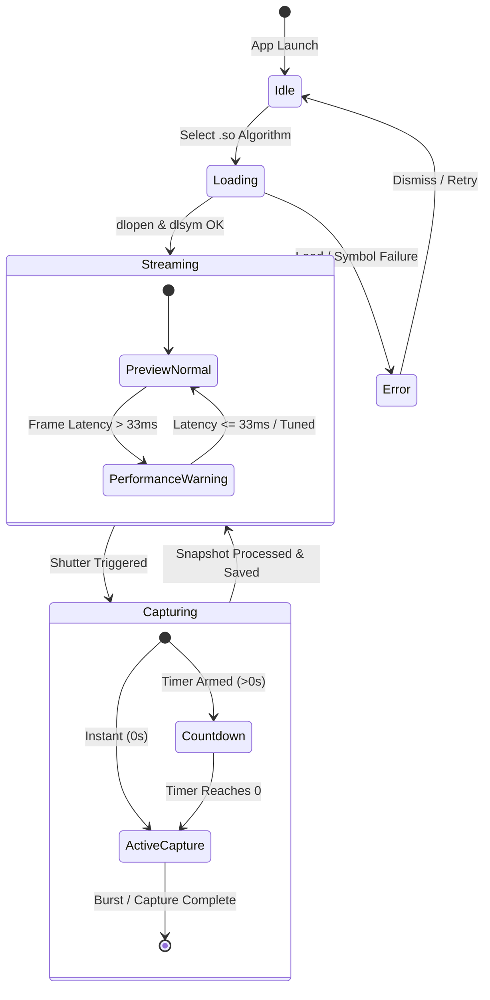

---

## 7. Data Contracts & Models

### 7.1 Native Plugin C Contract

Defined in [`app/src/main/cpp/contracts/plugin_contract.h`](../app/src/main/cpp/contracts/plugin_contract.h):

- **Symbol**: `extern "C" int process_frame(uint8_t* frame_data, const char* metadata_json)`
- **Memory Ownership**: `frame_data` points directly to the JVM `DirectByteBuffer` backing memory; the pointer is valid **only for the duration of the `process_frame` call**. Plugins must not cache the pointer across frames.
- **Return Convention**: `0` indicates success; any non-zero value indicates an error and maps to `JNI_FALSE` in `NativeBridge`.
- **Dynamic Lifecycle**: Calling `NativeBridge.loadPlugin(path)` automatically unloads any previously loaded shared library handle via `dlclose()` before calling `dlopen(path, RTLD_NOW)` and `dlsym(handle, "process_frame")`.

### 7.2 `CameraMetadata` JSON Schema

Serialized on the JVM by [`MetadataSerializer.kt`](../app/src/main/java/com/rtkcamera/nativebridge/MetadataSerializer.kt) and parsed natively by [`metadata_parser.cpp`](../app/src/main/cpp/core/metadata_parser.cpp):

```json
{
  "$schema": "http://json-schema.org/draft-07/schema#",
  "title": "CameraMetadata",
  "type": "object",
  "properties": {
    "width": { "type": "integer", "description": "Frame width in pixels" },
    "height": { "type": "integer", "description": "Frame height in pixels" },
    "stride": { "type": "integer", "description": "Row stride in bytes" },
    "format": { "type": "string", "enum": ["YUV_420_888", "RGBA_8888"] },
    "orientation": { "type": "integer", "enum": [0, 90, 180, 270] },
    "timestamp": { "type": "integer", "description": "Sensor capture timestamp in epoch nanoseconds" }
  },
  "required": ["width", "height", "format", "orientation", "timestamp"]
}
```

### 7.3 UI State Model (`CameraUiState`)

All UI state lives in immutable Kotlin data classes in [`CameraUiModels.kt`](../app/src/main/java/com/rtkcamera/ui/CameraUiModels.kt) and [`CameraViewModel.kt`](../app/src/main/java/com/rtkcamera/ui/CameraViewModel.kt), with pure, side-effect-free transition functions encapsulated in `CameraUiTransitions` for deterministic JVM unit testing:

- **Routing**: `ScreenRoute` (`VIEWFINDER`, `SNAPSHOT_INSPECTOR`)
- **Capture Modes & Lifecycle**: `CaptureMode` (`PHOTO`, `VIDEO`), `CaptureState` (`Idle`, `Countdown`, `VideoRecording`, `PhotoCapturing`)
- **Active Bottom Sheets**: `ActiveSheet` (`NONE`, `ALGORITHM_TUNING`, `PRO_PARAMETERS`, `AUTOMATED_CAPTURE`, `HELP`)
- **Parameter Sub-States**: `AlgorithmTuningState`, `ProParametersState`, `AutomatedCaptureState`, `AppSettingsState`, `FocusReticleState`, `TrackingOverlayState`, `SnapshotMetadata`

---

## 8. Key Architectural Decisions & Trade-Offs

| Decision | Chosen Approach | Rationale | Alternatives Considered |
| :--- | :--- | :--- | :--- |
| **JVM ↔ Native Frame Transport** | JNI `DirectByteBuffer` (`GetDirectBufferAddress`) | Zero-copy access to raw image buffers enables sub-33ms 30 FPS processing without GC pressure. | `GetByteArrayElements` (causes copies/pinning & GC stalls); `HardwareBuffer` (higher GPU interop complexity for CPU-first CV prototyping). |
| **Plugin Loading Mechanism** | Dynamic POSIX `dlopen` / `dlsym` via `NativeBridge` | Allows hot-swapping compiled `.so` libraries at runtime without recompiling the Android host app. | Static linking (requires full APK rebuild per algorithm iteration). |
| **Metadata Protocol** | UTF-8 JSON (`kotlinx-serialization` + `nlohmann/json`) | Human-readable, schema-extensible for future heterogeneous sensors (RTK GPS, IMU, Depth), and trivial for non-mobile researchers to consume. | Protobuf (added codegen/build friction); FlatBuffers (lower ergonomics for rapid research prototyping). |
| **Dependency Injection** | Dagger Hilt (`@Binds` `AlgorithmProcessor`) | Allows unit tests to swap `NativeBridge` for mocks without loading native `.so` binaries on the JVM. | Manual singletons (tight coupling, difficult test isolation). |
| **Camera Stack** | Android CameraX (`PreviewView` in Compose `AndroidView`) | Eliminates manufacturer-specific Camera2 boilerplate and automatically manages surface scaling, aspect ratios, and orientation transforms. | Raw Camera2 + manual `SurfaceView`/`TextureView` (high boilerplate, error-prone rotation math). |
| **Native Testing Strategy** | Desktop CMake + GoogleTest (`app/src/cpptest`) | Separates pure C++ core logic (`metadata_parser.cpp`, plugins) from Android JNI glue so tests run in milliseconds on the host workstation. | On-device-only instrumentation tests (slow build/deploy feedback loop). |

---

## 9. Repository Structure

```text
rtk-camera/
├── docs/
│   ├── HLD.md                           # This High-Level Design document
│   └── images/                          # Exported Penpot high-fidelity UI visuals
├── app/
│   ├── build.gradle                     # Android, Compose, CameraX, Hilt, CMake config
│   └── src/
│       ├── main/
│       │   ├── AndroidManifest.xml      # Camera & legacy external storage permissions
│       │   ├── cpp/
│       │   │   ├── CMakeLists.txt       # Builds librtkcamera.so and libdummy_plugin.so
│       │   │   ├── contracts/
│       │   │   │   └── plugin_contract.h    # Standardized C ABI entry point
│       │   │   ├── bridge/
│       │   │   │   └── native_bridge.cpp    # JNI bridge & dlopen/dlsym plugin loader
│       │   │   ├── core/
│       │   │   │   ├── metadata_parser.h
│       │   │   │   └── metadata_parser.cpp  # nlohmann/json CameraMetadata parser
│       │   │   └── plugin/
│       │   │       └── dummy_plugin.cpp     # Reference no-op plugin implementation
│       │   └── java/com/rtkcamera/
│       │       ├── RtkCameraApp.kt          # @HiltAndroidApp entry point
│       │       ├── camera/
│       │       │   ├── CameraManager.kt     # Async ProcessCameraProvider wrapper
│       │       │   ├── AnalysisPipeline.kt  # Real-time ImageAnalysis -> AlgorithmProcessor
│       │       │   ├── CapturePipeline.kt   # High-res ImageCapture -> GalleryRepository
│       │       │   └── GalleryRepository.kt # MediaStore atomic JPEG persistence
│       │       ├── di/
│       │       │   ├── CameraModule.kt      # Provides CameraManager
│       │       │   └── NativeModule.kt      # Binds NativeBridge -> AlgorithmProcessor
│       │       ├── nativebridge/
│       │       │   ├── AlgorithmInfo.kt     # Plugin registry descriptor
│       │       │   ├── AlgorithmProcessor.kt# SensorFrame & processor interface
│       │       │   ├── MetadataSerializer.kt# CameraMetadata JSON serializer
│       │       │   ├── NativeBridge.kt      # JNI wrapper
│       │       │   └── NativeLoader.kt      # Dynamic plugin loading service
│       │       └── ui/
│       │           ├── MainActivity.kt      # Edge-to-edge Compose host activity
│       │           ├── CameraViewModel.kt   # Reactive state, timers & telemetry polling
│       │           ├── CameraUiModels.kt    # Immutable UI models & pure state transitions
│       │           ├── ViewfinderScreen.kt  # CameraX PreviewView + layered HUD & sheets
│       │           ├── SnapshotInspectorScreen.kt # Full-res capture inspection screen
│       │           ├── components/          # TopHudBar, BottomControlDeck, Overlays & Sheets
│       │           ├── icons/               # Custom vector icon set (RtkIcons)
│       │           ├── previews/            # Compose @Preview gallery
│       │           └── theme/               # Dark tactical palette, typography & tokens
│       ├── test/java/com/rtkcamera/         # Kotlin JVM unit tests
│       ├── androidTest/java/com/rtkcamera/  # Compose instrumented UI tests
│       └── cpptest/                         # Host-runnable C++ GoogleTest suite
├── build.gradle
├── settings.gradle
├── AGENTS.md
├── LICENSE
└── README.md
```

---

## 10. Non-Functional Requirements & Success Criteria

| Criterion | Target Metric | Architectural Mechanism |
| :--- | :--- | :--- |
| **Developer Onboarding Speed** | Integrate and run a compiled `.so` plugin within **5 minutes**. | Single-header C ABI (`plugin_contract.h`), reference `dummy_plugin.cpp`, and runtime `dlopen` loading. |
| **Viewfinder Startup Latency** | Live back-camera feed displayed within **1 second** of opening the screen. | Asynchronous `ProcessCameraProvider` acquisition bound directly to Compose `LocalLifecycleOwner`. |
| **UI Responsiveness** | Minimum **30 FPS** UI interaction smoothness regardless of algorithm compute time. | Off-main-thread `ImageAnalysis` with `STRATEGY_KEEP_ONLY_LATEST` frame dropping and >33ms warning indicator. |
| **Snapshot Fidelity & Persistence** | **100%** of processed snapshots saved at full native sensor resolution (e.g., 12MP+) and indexed in system gallery. | Dedicated `ImageCapture` pipeline (`CapturePipeline`) + atomic `MediaStore` `IS_PENDING` write (`GalleryRepository`). |
| **Compatibility** | Android **API 24+** (Android 7.0 Nougat through Android 14 / API 34). | CameraX abstraction layer + version-branched `MediaStore` API (`Build.VERSION_CODES.Q`). |

---

## 11. Current Implementation Status & Roadmap

To keep this HLD accurate to the current repository state, the table below distinguishes **implemented production foundations** from **prototyped / upcoming integrations**:

| Subsystem | Current Status | Notes |
| :--- | :--- | :--- |
| **Live CameraX Viewfinder** | Implemented | `ViewfinderScreen` binds CameraX `Preview` via `AndroidView(PreviewView)` and handles runtime `CAMERA` permission. |
| **Compose HUD & Modal Sheets (Hi-Fi 01–07)** | Implemented | Full UI shell, state models, pure `CameraUiTransitions`, telemetry overlays, tuning/pro/automation/help sheets, and `SnapshotInspectorScreen`. |
| **Native JNI Bridge, Dynamic Loader & Metadata Parser** | Implemented | `NativeBridge`, `NativeLoader`, `MetadataSerializer`, `native_bridge.cpp` (`dlopen`/`dlsym`), `metadata_parser.cpp`, and `dummy_plugin.cpp` with unit & GTest coverage. |
| **Analysis & Capture Pipelines** | Implemented (Stand-Alone) | `AnalysisPipeline`, `CapturePipeline`, and `GalleryRepository` are built and DI-ready; binding `ImageAnalysis` and `ImageCapture` use cases alongside `Preview` in `ViewfinderScreen` and rendering processed preview output onto a viewfinder surface are next integration milestones. |
| **Hardware Pro Controls & Plugin Parameter Forwarding** | Prototyped in UI | Pro camera overrides (ISO/shutter/focus/WB), automated capture execution, camera lens switching, and forwarding tuning parameters into `CameraMetadata` JSON are currently represented in UI state transitions and ready for Camera2Interop / contract v2 wiring. |
| **Extended Sensor Metadata (RTK GNSS / IMU / Depth)** | Planned | Supported by design via extensible `CameraMetadata` JSON schema (Principle IV). |
